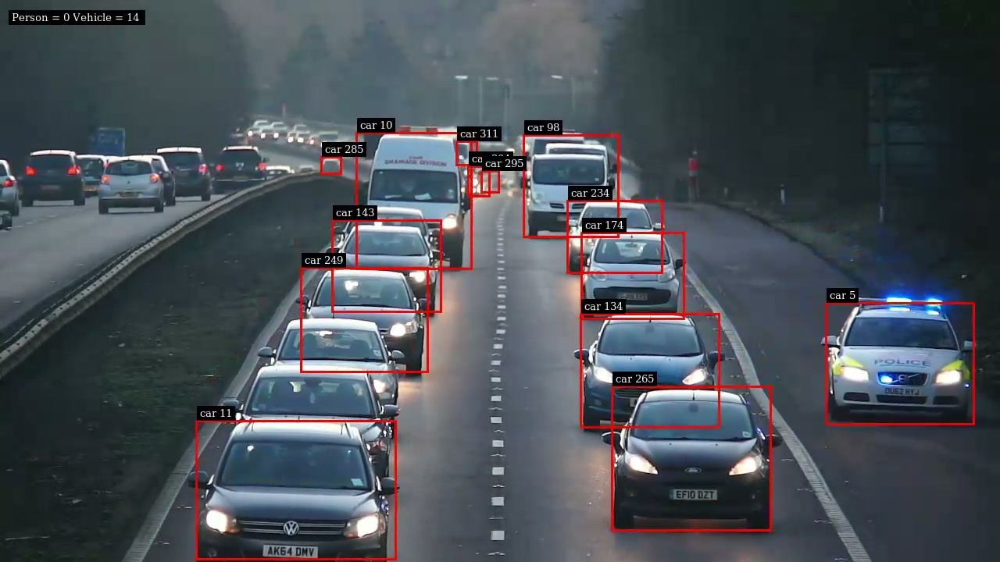
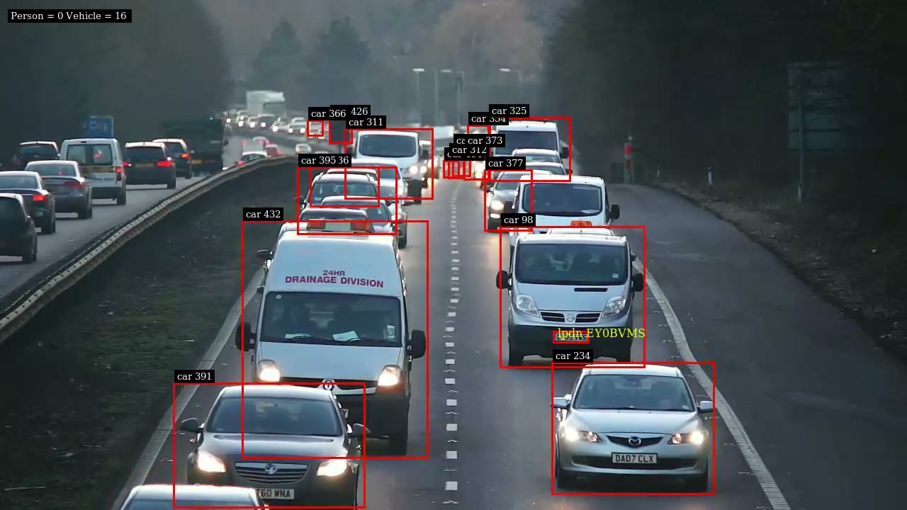
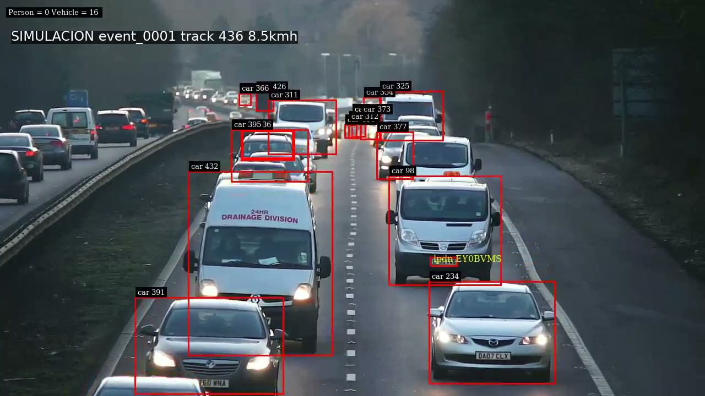

# Smart Radar AI — control de velocidad con NVIDIA DeepStream

> **`SIMULACIÓN — SIN VALIDEZ LEGAL`**: velocidades demo, matrículas no
> identificadas (`plate_unknown`) y sin calibración métrica. Nada de aquí es una sanción real.

Sistema local (sin nube) que procesa un video de tráfico con
**DeepStream 9.2 + modelos TAO**: detecta vehículos, les asigna ID con tracker
NvDCF, intenta leer matrículas (LPDNet + LPRNet) y genera tickets simulados con
evidencia para los eventos que superan el límite configurado.

## Demo

https://github.com/KarolBurrola/Deep-Learning-NVIDIA-DeepStream/raw/refs/heads/main/outputs/demo_preview.mp4

Multados con box seguidor (10s). Completo 60s: [multas_full.mp4](https://github.com/KarolBurrola/Deep-Learning-NVIDIA-DeepStream/raw/refs/heads/main/outputs/multas_full.mp4). Anotado DeepStream: [lpr_annotated.mp4](https://github.com/KarolBurrola/Deep-Learning-NVIDIA-DeepStream/raw/refs/heads/main/outputs/lpr_annotated.mp4). Video fuente: [Release v0.1-mvp](https://github.com/KarolBurrola/Deep-Learning-NVIDIA-DeepStream/releases/tag/v0.1-mvp).

## Fotos

**1. Detección normal** — boxes + IDs persistentes solo en calzada hacia cámara
(`outputs/lpr_annotated.mp4`):



**2. Placas** — LPDNet recorta y LPRNet escribe el texto (`lpdn ...`); el modelo USA
falla en placas UK, así que todo va a `plate_unknown` + revisión manual:



**3. Multa simulada** — box rojo seguidor + texto sobre el multado (`outputs/multas_full.mp4`):



## Herramientas usadas

### DeepStream 9.2
**Qué es**: SDK de NVIDIA para video-analítica con aceleración GPU total.
**Cómo se usa**: pipeline GStreamer `filesrc → decode → streammux → nvinfer (PGIE+SGIEs) → tracker → OSD → encode → filesink`, configurado con `.txt`/`.yml`.
**Aquí**: `TrafficCamNet → NvDCF → LPDNet → LPRNet` sobre `carros.mp4` → `lpr_annotated.mp4` + `tracks.jsonl` (exporter propio en el probe).

### Modelos TAO (100% preentrenados NVIDIA, 0 epochs locales)

### TrafficCamNet (detección de vehículos, PGIE)
**Qué es**: detector DetectNet_v2 con backbone ResNet18 podado, entrenado por
NVIDIA para 4 clases (`car, bicycle, person, road_sign`).
**Cómo se usa**: ONNX `resnet18_trafficcamnet_pruned.onnx` (5.2M) → engine
TensorRT FP16; entrada 960x544; aquí `batch-size 1`, `topk=40`,
`pre-cluster-threshold=0.2` (se bajó de 0.4 para recuperar el carril izquierdo).
**Para qué**: es el PGIE — propone todos los vehículos del frame que luego
sigue el tracker y recortan los SGIE.

### LPDNet-USA (detección de placas, SGIE)
**Qué es**: detector DetectNet_v2 podado especializado en matrículas USA.
**Cómo se usa**: ONNX `LPDNet_usa_pruned_tao5.onnx` (915K) → FP16; entrada
640x480; corre solo sobre vehículos (`operate-on-gie-id=1`), con gate propio
(los recortes <20px o fuera de ROI se descartan en el probe).
**Para qué**: entregar recortes de placa limpios a LPRNet. En este video dispara
~1130 veces; muchas son placas UK que el siguiente modelo no sabe leer.

### LPRNet-USA (lectura de caracteres, SGIE)
**Qué es**: clasificador secuencial (ResNet18 + CTC) que devuelve la cadena de
la placa; entrada fija 48x96, salida parseada por
`NvDsInferParseCustomNVPlate` + `dict_us.txt`.
**Cómo se usa**: ONNX `us_lprnet_baseline18_deployable.onnx` (56M) → FP16.
**Para qué**: leer el crop. Dato del fabricante: entrenado con ~310k placas USA
+ ~100k chinas (CCPD). En UK produce basura (`MWSLVSU`) con aciertos parciales
(`EY09VMS` vs real `EY09 VWS`) → toda salida se degrada a `plate_unknown`.

### TensorRT
**Qué es**: compilador de inferencia NVIDIA (fusiona capas, FP16/INT8).
**Cómo se usa**: aquí es automático — `nvinfer` genera el `.engine` la primera vez y lo reutiliza.
**Aquí**: convierte los 3 ONNX; sin esto no hay 60fps en 8GB.

### GStreamer
**Qué es**: framework de pipelines multimedia por plugins.
**Cómo se usa**: `gst-launch-1.0 ... ! nvv4l2decoder ! fakesink` para probar decode; la app arma el pipeline en C++.
**Aquí**: verificación Fase 1 y pipeline final de la app LPR.

### Docker + NVIDIA Container Toolkit
**Qué es**: contenedores con acceso a GPU (vía CDI: `--gpus all`).
**Cómo se usa**: `docker run --rm --gpus all -v repo:/workspace -v proyecto:/work deepstream:9.2...`.
**Aquí**: compilar (`make`) y correr la app sin instalar DeepStream en el host. Ver `docker-compose.yml`.

### WSL2 + driver Windows ≥595.45
**Qué es**: Ubuntu 26.04 virtualizado con la GPU del host.
**Cómo se usa**: todo el código vive en `/home/marti/yolo-nvidia` (nunca `/mnt/c`); el driver se instala solo en Windows.
**Aquí**: entorno único de build+run. Trucos en `docs/troubleshooting.md` (ej. `wsl --shutdown` tras update).

### `uv` + Python 3.13
**Qué es**: gestor de paquetes/entornos Python rápido (`uv run`, `uv sync`, nada de `pip`).
**Cómo se usa**: `uv run --project ~/yolo-nvidia python src/mvp.py ...`.
**Aquí**: `SpeedEstimator`, `ViolationEngine`, generación de tickets/clips y `tests/unit/test_speed.py`.

### ffmpeg 8
**Qué es**: navaja suiza de video por línea de comandos.
**Cómo se usa**: `ffprobe` (inspección), `-ss -i ... -frames:v 1` (evidencias), `drawbox`/`drawtext` con `enable='eq(n,FR)'` (box seguidor), `concat` (clips).
**Aquí**: `evidence.jpg`, `multas_demo/full.mp4`, `demo_preview.mp4`, frames de docs.

### vim / git / gh
**Qué es**: editor de terminal, versiones y CLI de GitHub.
**Cómo se usa**: todo el código se editó con vim; `scripts/run.sh` es el único entrypoint.
**Aquí**: este repo + Release `v0.1-mvp` con el video fuente.

## Por qué DeepStream y no solo YOLO

- **Todo en GPU, sin copias**: decode → inferencia → tracking → OSD → encode
  vía `NvBufSurface`. Medido ~60fps con 3 modelos en una laptop de 8GB; un
  YOLO en Python+OpenCV rebota cada frame CPU↔GPU y rinde menos a igual hardware.
- **Cascada nativa** coche → placa → caracteres (PGIE→SGIE) con parser propio y
  FP16 por modelo vía TensorRT, en vez de pegar tres repos.
- **Tracking con IDs integrado** (NvDCF); en YOLO lo añades tú (ByteTrack).
- **Cuándo YOLO gana**: instalación `pip` vs contenedor 27GB, reentrenar a placas
  UK trivial vs TAO pesado, más comunidad. Para un prototipo rápido, YOLO habría
  llegado antes al primer resultado; aquí se eligió rendimiento a escala.

## Cómo se calcula la multa

Detalle completo en [`docs/multa-metodo.md`](docs/multa-metodo.md): foot-point del
bbox con timestamps del video → velocidad demo (`px/s × 0.12`, `simulated: true`)
→ motor de eventos (track estable, sin duplicados, `plate_unknown`) → ticket con
evidencia. Sin homografía verificada no hay km/h real; la rama `calibrated`
existe pero está inactiva. **100% modelos preentrenados NVIDIA, 0 epochs locales.**

## Uso

```bash
./scripts/run.sh --input ~/yolo-nvidia/carros.mp4 --config configs/demo.yaml --output outputs/
```

- `configs/default.yaml`: límite 60 (realista, 0 eventos en este video).
- `configs/demo.yaml`: límite 8 (genera tickets simulados para ver el formato).
- Salidas: `lpr_annotated.mp4`, `tracks.jsonl`, `detections.csv`, `tracks.json`,
  `summary.json`, `tickets/event_XXXX/{ticket.json,ticket.html,evidence.jpg,trajectory.json}`,
  `multas_demo.mp4`, `multas_full.mp4`.

Requisitos: WSL2 + driver Windows ≥595.45, Docker con GPU, `uv` + Python 3.13.
El video y los pesos no van al repo: pon tu MP4 donde quieras y pásalo con
`--input`; los pesos se bajan con `scripts/download-tao.sh`.
Ver [`docs/troubleshooting.md`](docs/troubleshooting.md) y [`plan.md`](plan.md).

## Estructura

`src/{speed,violations,evidence,mvp.py}` · `tests/unit/` · `scripts/` ·
`configs/` · `docs/` · `patches/` (cambios C++ sobre `deepstream_tao_apps`: exporter
JSONL, ROI en probe, `lpr_app_yolo.yml`) · `docker-compose.yml` (referencia).
Pesos TAO y videos no van al repo: `scripts/download-tao.sh`.
